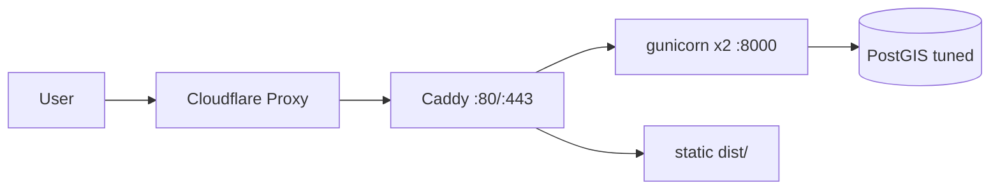

# Production deployment (single VPS + Cloudflare)

Target: single small VPS (Docker, Cloudflare edge).
Strategy: Docker for all runtimes; Cloudflare as edge only.

## Files

- [backend/Dockerfile.prod](../backend/Dockerfile.prod): `python:3.13-slim` + `gunicorn --workers 2 --threads 2`.
- [compose.prod.yml](../compose.prod.yml): tuned `db` (`shared_buffers=128MB`, `effective_cache_size=512MB`, `max_connections=30`), `backend`, `web` (Caddy).
- [Caddyfile](../Caddyfile): `/api/*`, `/admin/*`, `/static/*` to `backend:8000`; `/*` to `frontend/dist`.
- [.env.prod.example](../.env.prod.example): copy to `.env.prod` on VPS only, never commit.

## Prereqs already in branch

- `gunicorn==23.0.0` in `backend/requirements.txt`.
- `STATIC_ROOT = BASE_DIR / "staticfiles"` in `backend/config/settings.py`.
- `.env.prod`, `caddy_data/` in `.gitignore` (`frontend/dist/` was already ignored).

## Deploy

```bash
# build frontend in CI, not on the VPS
npm ci --prefix frontend && npm run build --prefix frontend
scp -r ./frontend/dist user@VPS:/opt/gonaj/frontend/dist
ssh user@VPS "cd /opt/gonaj && docker compose -f compose.prod.yml up -d --build"
ssh user@VPS "cd /opt/gonaj && docker compose -f compose.prod.yml exec backend python manage.py migrate"
ssh user@VPS "cd /opt/gonaj && docker compose -f compose.prod.yml exec backend python manage.py createcachetable"
ssh user@VPS "cd /opt/gonaj && docker compose -f compose.prod.yml exec backend python manage.py collectstatic --noinput"
```

Stop any host web server bound to `80/443` before Caddy starts, or reuse host web server instead of `web`.

Memory budget:

$$total \approx 250_{OS} + 250_{DB} + 2 \times 90_{workers} + 30_{caddy} \approx 710MB$$


