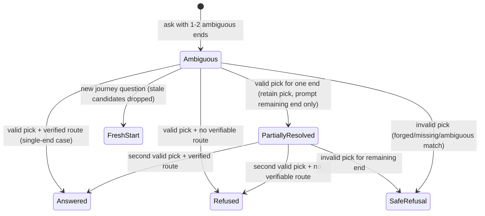

# Data Model: Journey Selection Resolve

**Feature**: [spec.md](spec.md) | **Date**: 2026-10-31

No schema change and no migrations. All entities below are transient request/response shapes carried in the stateless journey payload and validated in `backend/apps/journey/agent.py`. Canonical data (`Stop`, `Route`, memberships) is unchanged and read through the existing 003 helpers plus 006 endpoint annotations.

## Entities

### SelectionContext (request `context`)

Carried from the previous `disambiguate` response into the follow-up request. Stateless — the server stores nothing.

```python
# backend/apps/journey/agent.py — SelectionContext (transient dict, no model)
context = {
    "candidate_stop_ids": [201, 312],  # int list, the offered candidates
    "selected_stop_id": 201,           # int, the passenger pick (bool excluded)
    "slot": "from",                   # "from" | "to"
    "resolved": {"id": 11, "name": "Ernakulam South"},  # other end, id is int
}
```

| Field | Type | Rule |
|-------|------|------|
| `candidate_stop_ids` | `int[]` | Non-empty for a selection; every entry `int` (not `bool`) |
| `selected_stop_id` | `int` | Must be a member of `candidate_stop_ids`, else invalid |
| `slot` | `string` | Exactly `from` or `to`, else invalid |
| `resolved` | `{id: int, name: str}` | `id` must be `int` (not `bool`); names the already-fixed other end |

### CandidateSet (response `candidates`)

```python
# one entry per offered stop; duplicates are ordinary distinct entries
{"id": 201, "name": "North Hub", "detail": "നോർത്ത് ഹബ്"}
```

- Identity is `id`; display is `name` plus `detail` (distinguishing detail where same-named stops exist).
- `detail` is `name_ml` when present, else rounded `lat,lon` (4 decimals); it is additive and optional so old `{id, name}` assertions keep passing.
- Same-road opposite-side duplicates stay as two entries; picking either advances normally.

### DisambiguationState (response when ambiguous)

Single-end (existing shape, unchanged):

```python
{"status": "disambiguate", "message": str, "candidates": [{"id": int, "name": str}]}
```

Both-ends-ambiguous (extended — replaces the old `(None, None)` dead end):

```python
{
    "status": "disambiguate",
    "slots": {"from_ids": [101, 102], "to_ids": [201, 312]},
    "surviving_context": {"other_end_ids": [...]},
    "message": str,
    "candidates": [...],  # currently prompted end
}
```

### ResolvedJourney (fast-path input to `find_routes`)

```python
(from_id: int, to_id: int)  # return of _resolve_selection(context, question_text), or None
```

- Produced only when all `SelectionContext` validations pass.
- `selected_stop_id` arrives directly on the click path; on the typed path it is derived by unambiguous text match against the offered candidates in order: case-insensitive exact name matching exactly one candidate, or a 1-based position / ordinal (`1`, `first`, `second`, …) matching exactly one slot entry.
- Fed directly to `tools.find_routes(from_stop_id=..., to_stop_id=...)`, then each route re-checked by `_verify_route` (`from_position < to_position` on a servable route).

### VerifiedAnswer / HonestRefusal (fast-path outputs)

- `VerifiedAnswer`: existing `_answer_payload` shape — names resolved stops, every route has `/routes/:id` evidence, no times, no transfers.
- `HonestRefusal`: `{"status": "refuse", "message": _NO_DIRECT | _UNKNOWN_PLACE | unmatched-pick}` — no invented stops/routes, bounded next step where applicable.

## Validation rules

1. `selected_stop_id` must be `int` (reject `bool`, `str`, `None`) and a member of `candidate_stop_ids`.
2. `slot` must be `from` or `to`.
3. `resolved.id` must be `int` (reject missing/`None`/non-int `resolved`).
4. A reply matching zero or more than one listed candidate is invalid → safe refusal, never an invented journey. This applies equally to text matching (name/position text matching zero or several candidates is invalid).
5. Stale IDs (stop deleted since prompt) behave as unknown → honest refusal.
6. Every `disambiguate` response carries `slot`, `offered_ids`, and per-candidate `detail` (single-end and both-ends alike); both-ends responses additionally carry `slots` and `surviving_context`.
7. Selection fast-path responses carry `meta.resolution == "selection"`; the model-outage fallback carries no `resolution` key.

## State transitions



- Valid pick never returns the identical candidate prompt for the already-picked stop.
- A new journey question while a prompt is pending starts fresh; stale `candidate_stop_ids` never leak into the new answer.
