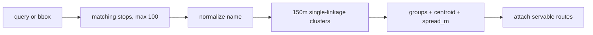

# Data Model: Place Groups for Same-Named Stops

**Feature**: [spec.md](spec.md) | **Date**: 2026-10-31

No schema change and no migrations. Grouping is computed at request time from the canonical `Stop` table (name, name_ml, lat, lon) through the existing 003 query layer. All entities below are transient return shapes from `backend/apps/journey/tools.py`.

## Entities

Spec-to-field map: representative location → `center`, spread → `spread_m`, route hints → `routes` + `route_count`, display name → `label`.

### PlaceGroup (one `groups[]` entry)

```python
{
    "key": "kaloor#1",            # normalized name + cluster index, stable for unchanged data
    "label": "Kaloor",            # display name (first member's name by (name, id) order)
    "center": {"lat": 9.9900, "lon": 76.2900},  # centroid (mean of members)
    "bbox": {"min_lat": ..., "min_lon": ..., "max_lat": ..., "max_lon": ...},
    "spread_m": 42.5,             # max pairwise haversine distance between members, meters
    "members": [{"id": 612, "name": "Kaloor", "lat": 9.99, "lon": 76.29}],
    "route_count": 3,             # total serving routes (uncapped)
    "routes": [{"id": 17, "name": "Aluva — Kaloor"}],  # by name, capped at 10
}
```

| Field | Type | Rule |
|-------|------|------|
| `key` | `string` | `"lowercased-stripped-name#index"`; unique within one response; stable for unchanged data |
| `label` | `string` | Display name of the place |
| `center` | `{lat, lon}` | Arithmetic mean of member coordinates |
| `bbox` | bounds | Min/max member coordinates (degenerate to the point for singles) |
| `spread_m` | `float` | Max pairwise member distance in meters; `0` for single-member groups |
| `members` | `array` | Every member stop as `{id, name, lat, lon}`; opposite-side duplicates are ordinary members |
| `route_count` | `int` | Exact count of distinct servable routes serving any member |
| `routes` | `array` | Serving routes as `{id, name}`, ordered by `(name, id)`, first 10 |

### RoutePair (one `find_routes_matrix` `pairs[]` entry)

```python
{
    "from_stop_id": 501,
    "to_stop_id": 502,
    "routes": [{"id": 17, "name": "Aluva — Kaloor", "evidence": "/routes/17"}],
}
```

- Only pairs with ≥1 verified direct route appear (`position[from] < position[to]` on a servable route, same check as `find_routes`).
- `evidence` is a frontend `/routes/:id` address, never an `/api/v1/` URL.

## Validation rules

1. Grouping key is the casefolded, stripped stop name; empty names never group.
2. Two stops join one cluster only when linked by ≤150 m haversine hops (single-linkage).
3. Same normalized name beyond 150 m linkage forms a separate group (`#2`, `#3`, …).
4. `spread_m` is computed in meters with the same haversine used for clustering.
5. `routes`/`route_count` count distinct servable routes only (same `servable_routes` definition as 003/004).
6. `search_places` accepts exactly one of `query`/`bbox`; oversized bbox returns `zoom_in`; empty areas return `empty`; at most `RESULT_LIMIT 100` stops enter grouping.

## State transitions

None — pure read-time derivation. Groups always reflect current stop data; re-imports change groups with no retained state.


