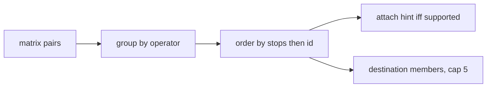

# Data Model: Ranked Journey Options

**Feature**: [spec.md](spec.md) | **Date**: 2026-10-31

No schema change and no migrations. Ranking is computed per request from `find_routes_matrix` output plus the existing operator/endpoint annotations. All entities below are transient answer shapes in `backend/apps/journey/agent.py`.

## Entities

### OperatorGroup (one `option_groups[]` entry)

```python
{
    "operator": "KSRTC",          # annotated operator; "Other services" when unknown
    "options": [
        {
            "route": {"id": 17, "name": "Aluva — Kaloor", "evidence": "/routes/17"},
            "boarding_stop": {"id": 501, "name": "Aluva"},
            "alighting_stop": {"id": 502, "name": "Kaloor"},
            "boarding_hint": "Board at Aluva",   # only when dataset-supported
            "stop_count": 9,                     # route stop count (ranking input)
        }
    ],
}
```

| Field | Type | Rule |
|-------|------|------|
| `operator` | `string` | Annotated operator; `"Other services"` when null/blank; groups ordered by name, unknown last |
| `options` | `array` | Verified pairs only, ordered by `stop_count` ascending then route id ascending |
| `boarding_hint` | `string`, optional | `stop.name` plus `resolved_origin` context when available; absent otherwise — never invented |
| `stop_count` | `int` | Ordered membership count of the route (ranking input, exposed for audit) |

### DestinationOption (one `destinations[]` entry, max 5)

```python
{"stop": {"id": 502, "name": "Kaloor"}, "evidence": "/routes/17"}
```

- Only reachable members (matrix-verified) appear, in matrix order; further options counted in prose, never listed.

## Validation rules

1. Every option passes `_verify_route` (`from_position < to_position` on a servable route).
2. Option order is deterministic: `(operator name, stop_count, route id)` for unchanged data.
3. A boarding hint appears only when `resolved_origin`/`stop.name` support it; no stand table exists.
4. `destinations` holds at most 5 entries, each evidence-linked.
5. Drafts failing `_FORBIDDEN_SHAPED` get one repair attempt, then refusal — per option set, unchanged.
6. Single verified option returns a one-item list; nothing is invented to look ranked.

## State transitions

None — ranking derives per request from matrix output; no stored state.


