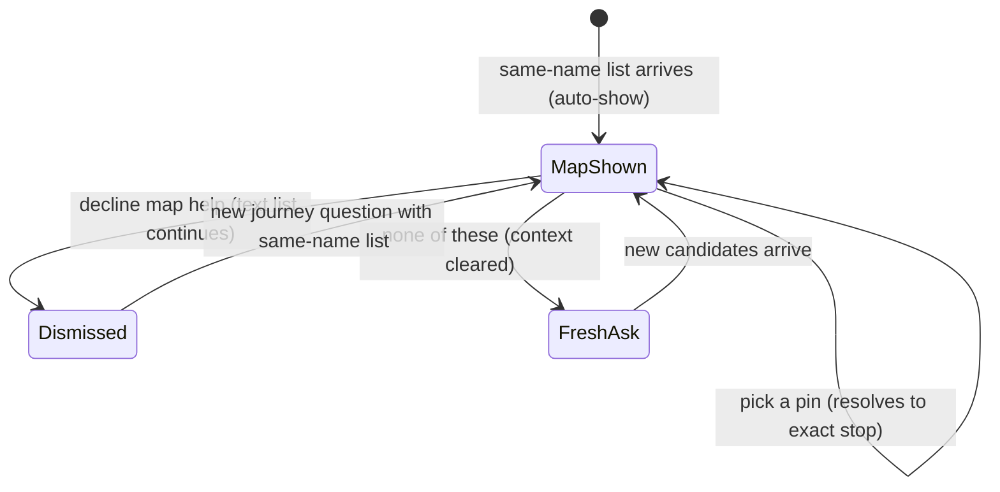

# Data Model: Choose on the Map

**Feature**: [spec.md](spec.md) | **Date**: 2026-10-31

No schema change and no migrations. All entities below are transient frontend state plus two additive backend fields (`lat`/`lon` on `disambiguate` candidates).

## Entities

### CandidatePin (one fitted-view `stops[]` entry)

```javascript
{ id: 612, name: "Kaloor", lat: 9.99, lon: 76.29, detail: "10.0500,76.3000" }
```

| Field | Type | Rule |
|-------|------|------|
| `id` | `int` | Candidate identity; pin tap resolves via the 008 protocol |
| `lat` / `lon` | `float` | From additive backend fields; required to place the pin |
| `detail` | `string`, optional | Rendered after the name, as today |

### FittedViewport (one `onShowCandidates` view)

```javascript
{
  bounds: { south: 9.98, west: 76.28, north: 9.99, east: 76.30 },
  stops: [CandidatePin],
}
```

- Bounds are the min/max over candidate coordinates (and 009 group bboxes when present); `null` clears the candidate view.
- Computed client-side on every `disambiguate` response.

### Dismissal (per-exchange map-help state)

```javascript
{ mapHelpDismissed: false }
```

- `true` hides map help until the next journey question; never persisted.

### NoneOfThese (guided retry action)

- Clears `history` to `[]` and `context` to `{}` and re-asks as a fresh question with rephrase help; stale candidates never leak.

## Validation rules

1. Every `disambiguate` response used for map help carries `lat`/`lon` per candidate (additive backend fields).
2. The fitted bounds always contain every candidate pin on first display.
3. Pin taps send byte-identical 008 selection payloads to list-button picks.
4. Opt-out journey payloads contain no coordinates; the geolocation API is never invoked unless explicitly opted in.
5. Decline state resets on each new journey question.

## State transitions


