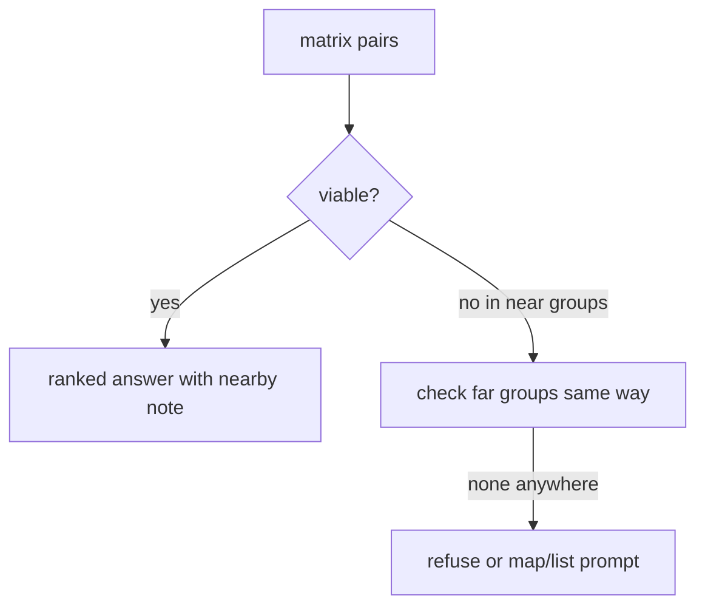

# Journey Agent Loop

Deterministic analyze-first flow. Replaces ask-first disambiguation.
Server verifier runs after every draft.

## Inputs

```python
question: str  # e.g. "How do I reach from aluva to kaloor"
history: list  # last 6 user/assistant turns
context: dict  # selection state, if any
location: dict | None  # {"lat": float, "lon": float, "accuracy_m": float} when shared
```

## Steps

### 0. Selection entry (no shortcut)

If `context` carries `candidate_stop_ids` + `slot` + `selected_stop_id`,
treat the pick as a member selector only. Enter Step 1 group lookup for its
group, then test via `find_routes_matrix`. Never answer via single-pair
`find_routes` before groups. On partial, derive the other end via
`search_places`, else prompt the remaining slot.

### 1. Group both ends

```python
from_groups = search_places(query="aluva")["groups"]  # e.g. aluva#1
to_groups = search_places(query="kaloor")["groups"]    # kaloor#1={K1,K2,K3}, kaloor#2={K4,K5}
```

Collect all member ids per group. Cap 100 stops pre-grouping.

### 1b. Location variant (next feature, no extra loop)

If `location` present, origin ids come from `nearby_stops(lat,lon,radius_m)` instead of `search_places(query)`:

```python
origin_stops = nearby_stops(lat=10.10, lon=76.35, radius_m=500)["stops"]
# destination groups unchanged: search_places(query="kaloor")
pairs = find_routes_matrix(from_ids=[s["id"] for s in origin_stops], to_ids=[...])
```

Steps 2–6 unchanged. Only Step 1 source differs. `bbox` path in `search_places`/`search_stops` remains as fallback when location absent or stale.

### 2. Matrix test

```python
pairs = find_routes_matrix(from_ids=[...], to_ids=[...])["pairs"]
# only pairs with pos_from < pos_to on servable route survive
```

No pair invented. Opposite travel direction drops out; opposite-side members are tested independently.

### 3. Classify per route

For each viable `route_id`:

```python
detail = get_route_detail(route_id)
direct = exact member with membership row
nearby = [m for m in same group if distance_m(direct, m) <= 150.0]
```

Distance via haversine:

$$d = 2R \arcsin\left(\sqrt{a}\right), \quad R = 6371000.0$$

where $a = \sin^2(\Delta\phi/2) + \cos\phi_1\cos\phi_2\sin^2(\Delta\lambda/2)$.

### 4. Rank and answer

Group by `operator`, order by `(stop_count, route_id)`.
Emit per route: exact alighting `id` + `also_nearby[{id, walk_m}]` + `evidence`.
Destinations capped at 5.

### 5. Fallback



Map/list prompt only here, with `slot`, `offered_ids`, `resolved`, `slots` payload.

### 6. Verify

Extract `/routes/(\d+)` from draft. Reject if forbidden regex matches.
Re-check each via `get_route_detail` for `pos_from < pos_to`.
One repair retry, then `refuse`.

## Future extension

Far groups (`kaloor#2`) checked after near groups.
Walk radius `500m` via `nearby_stops(lat,lon,radius_m)` for onward corridor stops.
Same loop, larger radius, labeled as walk + onward.
